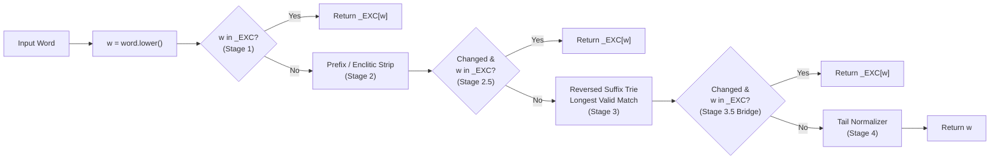

# LemmaJet Model & Inference Architecture (Universal Specification)

This document explains **what a compiled LemmaJet model contains**, **how the 4-stage inference pipeline executes**, and **how the Synthetic Stem-Bridge trick unifies stemming and lemmatization** under a single ultra-fast runtime.

It serves as the **language-agnostic specification** referenced by all target-specific emitter guides ([Python](python-emitter-optimizations.md), [JavaScript](javascript-emitter-optimizations.md), and [C/Rust/Go/Java Playbook](experiments-catalog-and-cross-language-playbook.md)).

> **Distribution Notice**:
> This canonical document is bundled into both the Python standalone distribution (`pkg/py/docs/`) and the JavaScript distribution (`pkg/js/docs/`). Complete multi-language documentation and benchmarking catalogs reside under `docs/internals/` in the main repository.

---

## 1. Stemmers vs. Lemmatizers: One Engine, Two Objectives

LemmaJet compiles both **stemmers** (`target_mode = "stem"`) and **lemmatizers** (`target_mode = "lemma"`) into the **exact same data structure and 4-stage execution pipeline**:

| Property | Stemmer (`target_mode = "stem"`) | Lemmatizer (`target_mode = "lemma"`) |
| :--- | :--- | :--- |
| **Goal** | Map all inflected forms of a lexeme to a shared equivalence-class string (ADR-01). The output does not need to be a dictionary word (e.g. `running, runs, ran -> run`; `kobiety, kobietom -> kobiet`). | Map every inflected form to its exact dictionary citation form / lemma (e.g. `running, runs, ran -> run`; `kobiety, kobietom -> kobieta`; `widziałem, widzieli -> widzieć`). |
| **Dominant Trie Rules** | **~80–96% pure truncations** (`cut = k, add = ""`). Drops inflectional suffixes down to the invariant root. | **~65–70% `(cut, add)` alternations** (`cut = k, add = s`). Strips inflectional endings and appends the canonical lemma ending (`-a`, `-ć`, `-ować`, `-y`). |
| **Role of `_EXC`** | Captures suppletive roots (`went -> go`, `byli -> być`) and stem alternations not handled by the pruned trie. | Captures both irregular surface words AND **post-trie synthetic stem bridges** (e.g. `widziać -> widzieć`). |

---

## 2. Anatomy of a Compiled Model (`<profile>.json`)

A serialized compiled model (`CompiledStemmerModel`) is a JSON object with five top-level keys:

```json
{
  "exceptions": {
    "went": "go",
    "was": "be",
    "widziać": "widzieć"
  },
  "affix_stripper": {
    "min_remaining_len": 4,
    "prefix": "",
    "enclitics": [],
    "prefix_trie": {
      "n": {
        "a": { "j": { "": 3, "a": { "z": 0 } } },
        "i": { "e": { "": 3, "b": { "o": 0 } } }
      }
    }
  },
  "trie": {
    "min_stem_len": 3,
    "root": {
      "s": 1,
      "g": { "ni": 3 },
      "ł": { "a": [1, "ć"] },
      "i": [0]
    },
    "dag": [
      { "m": { "a": 3 } }
    ]
  },
  "tail_normalizer": {},
  "metadata": {
    "name": "general_md-balanced",
    "language": "pl",
    "target_mode": "lemma"
  }
}
```

### How Each Component Is Encoded

1. **`exceptions` (`dict[str, str]`)**:
   - An $O(1)$ hash map from lowercase string keys to target stems/lemmas.
   - Checked at **three points** during inference:
     - **Stage 1 (Surface)**: Before any affix or suffix stripping (catches suppletives like `"went" -> "go"`).
     - **Stage 2.5 (Post-Prefix)**: Immediately after stripping a prefix (if a prefix was stripped).
     - **Stage 3.5 (Post-Trie Stem Bridge)**: Immediately after applying the suffix trie rule (if the trie modified the word).

2. **`affix_stripper` (`AffixStripper`)**:
   - **`min_remaining_len` (`_AFF_MIN`, default `3` or `4`)**: Minimum number of characters that must remain in the word after stripping a prefix or enclitic.
   - **`prefix_trie` (`_PFX_TRIE`)**: A **forward** character trie induced automatically from the corpus via the *Remainder-is-a-Word* principle (e.g., Polish superlative `naj-` and negation `nie-`).
     - Internal nodes store an integer cut under `""` (e.g. `n -> a -> j -> {"": 3}` means "cut 3 chars from the front").
     - **Protective `0` overrides**: False-prefix roots like Polish `najazd` ("invasion", not `naj- + azd`) or `niebo` ("sky", not `nie- + bo`) have longer paths in `prefix_trie` with operation `0` (`n -> a -> j -> a -> z -> 0`). Because prefix matching uses **longest match**, walking `najazd` hits `3` at `naj` and then overrides `best_p` back to `0` at `najaz`, protecting the root from prefix stripping!
   - **`prefix` (`str`)** & **`enclitics` (`list[str]`)**: Optional single-prefix fallback and movable suffix clitics.

3. **`trie` (`SuffixTrieModel`) — The Reversed Suffix Transducer**:
   - Matches characters **from the end of the word toward the beginning** (`w[len - 1]` down to `w[0]`), tracking the **longest valid match**.
   - **`min_stem_len` (`_MSL`, typically `2` or `3`)**: Every candidate `(cut, add)` operation at a trie node is **only valid** for a word of length $L = \text{len}(w)$ if:
     1. **At least 1 base character remains after cutting**: $L - \text{cut} \ge 1$ (except for the identity no-op $\text{cut}=0, \text{add}=\text{""}$), AND
     2. **The resulting stem meets `min_stem_len`**: $L - \text{cut} + \text{len}(\text{add}) \ge \text{min\_stem\_len}$.
   - **Node & Operation Encoding in JSON**:
     - **Pure truncation op (`add == ""`)**: Encoded as a bare integer `cut` (e.g. `3` means `(cut=3, add="")`).
     - **Alternation op (`add != ""`)**: Encoded as a 2-element list `[cut, add]` (e.g. `[1, "ć"]` means cut 1 char from the end and append `"ć"`).
     - **Leaf node**: Stored directly as its operation value (`3` or `[1, "ć"]`).
     - **Internal branching node**: Stored as a JSON object `{"a": child_a, "e": child_e, "": self_op}` where single-character keys are transitions and `""` (if present) holds the operation at this node.
     - **Radix-compressed edge**: Multi-character keys like `"ni": 3` inside `"g"` represent a compressed chain of single-character transitions (`g -> n -> i`). Note that in the JSON trie, multi-character radix keys are stored in reversed traversal order (`k[0]` is matched first, then `k[1]`, etc.).
     - **DAG pointer**: A 1-element integer list `[dag_id]` (when `dag` is non-empty) points to a shared subtree `trie["dag"][dag_id]`.

4. **`tail_normalizer` (`dict[str, str]`)**:
   - Optional Stage 4 suffix replacement table sorted by pattern length descending; replaces stem-final `pattern` with `replacement` if `len(w) - len(pattern) >= 2`.

---

## 3. Reference Inference Algorithm (Clean Pseudocode)

Below is the exact, canonical semantics of `CompiledStemmerModel.stem(word)`. Every target emitter (`py`, `js`, `sbl`, and future `c`, `rust`, `go`, `java`) **must produce bit-for-bit identical outputs** to this specification:

```python
def stem(word: str) -> str:
    # 0. Empty guard & case folding
    if not word:
        return ""
    w = word.lower()

    # =========================================================================
    # STAGE 1: Surface Exception Lookup (O(1))
    # =========================================================================
    if w in EXCEPTIONS:
        return EXCEPTIONS[w]

    # =========================================================================
    # STAGE 2: Forward Prefix Trie & Enclitic Stripping
    # =========================================================================
    w_before_affix = w

    # 2a. Longest-match forward prefix trie (with protective 0-cut overrides)
    if PREFIX_TRIE and len(w) > AFF_MIN:
        node = PREFIX_TRIE
        best_prefix_cut = 0
        for ch in w:
            if not is_dict(node) or ch not in node:
                break
            node = node[ch]
            op = node.get("") if is_dict(node) else node
            # Valid if remaining word >= AFF_MIN, or if op == 0 (protective override!)
            if is_int(op) and (len(w) - op >= AFF_MIN or op == 0):
                best_prefix_cut = op
        if best_prefix_cut > 0:
            w = w[best_prefix_cut:]

    # 2b. Enclitic stripping (if configured)
    for enc in ENCLITICS:
        if w.endswith(enc) and len(w) - len(enc) >= AFF_MIN:
            w = w[: -len(enc)]
            break

    # 2.5. Post-Prefix Exception Lookup (only if Stage 2 modified `w`)
    if w != w_before_affix and w in EXCEPTIONS:
        return EXCEPTIONS[w]

    # =========================================================================
    # STAGE 3: Reversed Suffix-Trie Transducer (Longest Valid Match)
    # =========================================================================
    w_len = len(w)
    node = TRIE_ROOT
    best_op = None  # tuple (cut: int, add: str)

    # Check root operation (depth 0) if present
    if node.op is not None and is_valid_op(node.op, w_len, MIN_STEM_LEN):
        best_op = node.op

    # Walk characters from right to left: w[w_len - 1], w[w_len - 2], ...
    for i in range(w_len - 1, -1, -1):
        ch = w[i]
        if ch not in node.children:
            break
        node = node.children[ch]
        if node.op is not None and is_valid_op(node.op, w_len, MIN_STEM_LEN):
            best_op = node.op

    # Apply the longest valid (cut, add) rule
    if best_op is not None:
        cut, add = best_op
        if cut > 0 or add != "":
            w_stemmed = (w[:-cut] if cut > 0 else w) + add
            if w_stemmed != w:
                w = w_stemmed
                # =============================================================
                # STAGE 3.5: Post-Trie Synthetic Stem-Bridge Lookup (O(1))
                # =============================================================
                if w in EXCEPTIONS:
                    return EXCEPTIONS[w]

    # =========================================================================
    # STAGE 4: Stem-End Tail Normalizer (if configured)
    # =========================================================================
    for pattern, replacement in TAIL_RULES_LONGEST_FIRST:
        if w.endswith(pattern) and len(w) - len(pattern) >= 2:
            w = w[: -len(pattern)] + replacement
            break

    return w


def is_valid_op(op: tuple[int, str], w_len: int, min_stem_len: int) -> bool:
    cut, add = op
    if cut == 0 and add == "":
        return w_len >= min_stem_len
    return (w_len - cut >= 1) and (w_len - cut + len(add) >= min_stem_len)
```

---

## 4. Concrete Walkthrough Examples



### Example A: Surface Suppletive Exception (`"Went" -> "go"`)
1. Lowercase: `"Went"` $\to$ `w = "went"`.
2. **Stage 1**: `"went"` is found in `_EXC` $\to$ immediately returns `"go"` in $O(1)$ without touching the prefix or suffix tries.

### Example B: Protective Prefix Override (`"najazd"` vs `"najlepszego"` in Polish)
1. **Case 1 (`"najlepszego"`, superlative of *dobry/lepszy*)**:
   - Stage 1: `"najlepszego"` not in `_EXC`.
   - Stage 2 (`_PFX_TRIE`): Walks `n -> a -> j` (records `best_p = 3`), next char `'l'` is not in `j`'s children $\to$ loop breaks.
   - Cuts 3 chars: `w = "lepszego"`.
   - Stage 3 (Suffix Trie): Walks `o -> g -> e -> z -> s` from the end of `"lepszego"` and cuts `-ego` / `-szego`.
2. **Case 2 (`"najazd"`, noun meaning "invasion")**:
   - Stage 2 (`_PFX_TRIE`): Walks `n -> a -> j` (records `best_p = 3`), continues to `a -> z` where the node has protective operation `0`!
   - Since `op == 0` is explicitly allowed by `len(w) - op >= _AFF_MIN or op == 0`, `best_p` is overwritten with `0`.
   - Prefix is **not** stripped; `"najazd"` proceeds intact to Stage 3.

### Example C: The Synthetic Stem-Bridge Trick (`"widziałem" -> "widzieć"`)
Why do Polish lemmatizers contain seemingly non-dictionary keys in `_EXC` like `"widziać": "widzieć"`, `"słyszać": "słyszeć"`, or `"prowadzyć": "prowadzić"`?

This is the **Synthetic Stem-Bridge** mechanism implemented in the compiler's exception extractor (`ExceptionsExtractor`):

1. **The Linguistic Problem**:
   - In Polish, the overwhelming majority of verbs with past-tense stem `-ał-` have an `-ać` infinitive:
     - `czytał, czytała, czytali, czytałem` $\to$ `czytać`
     - `pisał, pisała, pisali, pisałem` $\to$ `pisać`
   - Therefore, the MDL-pruned suffix trie learns the general majority rules:
     - `-łem` $\to$ cut `3`, add `"ć"`
     - `-ł` $\to$ cut `1`, add `"ć"`
     - `-ła` $\to$ cut `2`, add `"ć"`
   - However, a small class of high-frequency verbs (`widzieć`, `słyszeć`, `chcieć`, `wiedzieć`) have `-ał-` in the past tense (`widziałem, widział, widziała`) but `-eć` in the infinitive (`widzieć`)!

2. **Naive Exception Approach (Wasteful)**:
   - Without stem bridges, you would have to insert **every single inflected form** into `_EXC`:
     `"widziałem": "widzieć"`, `"widziałeś": "widzieć"`, `"widział": "widzieć"`, `"widziała": "widzieć"`, `"widziało": "widzieć"`, `"widziano": "widzieć"`, etc. — burning **10 to 20 exception budget slots per verb**!

3. **LemmaJet's Synthetic Stem-Bridge Solution (1 Slot Covers the Whole Paradigm)**:
   - When `widziałem`, `widział`, `widziała`, `widziało` pass through Stage 3 (the general suffix trie), the regular `-łem -> -ć`, `-ł -> -ć`, `-ła -> -ć` rules collapse **all of them** into the same intermediate synthetic string: **`"widziać"`**!
   - During compilation (residual exception extraction), the exception extractor runs the entire training vocabulary through the Stage 3 trie, observes that dozens of residual forms of `widzieć` all land on the intermediate stem `"widziać"` (and no other dominant lemma uses `"widziać"`), and inserts **a single stem-bridge entry** into `_EXC`:
     ```json
     "widziać": "widzieć"
     ```
   - At runtime:
     1. `"widziałem"` misses Stage 1 `_EXC`.
     2. Stage 3 trie applies `cut=3 ("łem"), add="ć"` $\to$ produces `"widziać"`.
     3. **Stage 3.5** checks `_EXC["widziać"]` $\to$ hits `"widzieć"` and returns `"widzieć"`!

### Empirical Proof of Stem-Bridge Efficiency (`md-balanced`, 450 exceptions)

Across the full 473,361-word Polish vocabulary and 98,749-word English vocabulary:

| Model | Vocabulary $V$ | Stage 1 Hits (Surface) | Stage 2.5 Hits (Post-Prefix) | Stage 3.5 Hits (Post-Trie Bridge) | Unique `_EXC` Keys Used as Bridges |
| :--- | :---: | :---: | :---: | :---: | :---: |
| **`pl/stemmers/md-balanced`** | 473,361 | 59 | 3 | **11,526** | **450 / 450 (100%)** |
| **`pl/lemmatizers/md-balanced`** | 473,361 | 81 | 16 | **7,546** | **447 / 450 (99.3%)** |
| **`en/stemmers/md-balanced`** | 98,749 | 430 | 0 | **96** | **55 / 450 (12.2%)** |
| **`en/lemmatizers/md-balanced`** | 98,749 | 441 | 0 | **65** | **40 / 450 (8.9%)** |

In Polish, **450 exception slots correct over 7,500 to 11,500 inflected words** (~17–25 inflected words per exception entry!) thanks to Stage 3.5 stem bridging.

---

## 5. Mathematical Invariants Exploited by Target Optimizers

Understanding the universal pipeline reveals four mathematical invariants that target emitters can precompute at compile time or module load time without altering a single output string:

1. **Folded Length Threshold (`need`)**:
   - The validity check `(w_len - cut >= 1) and (w_len - cut + len(add) >= msl)` depends **only** on `w_len`!
   - Rewriting the two inequalities for `w_len`:
     $$\text{need} = \begin{cases} \text{cut} + \text{msl} & \text{if } \text{add} = \text{""} \\ \max(\text{cut} + 1,\; \text{cut} + \text{msl} - \text{len}(\text{add})) & \text{if } \text{add} \ne \text{""} \end{cases}$$
   - At runtime, the entire compound condition reduces to a **single integer comparison**: `need <= w_len`!

2. **Compile-Time Stem-Bridge Reachability (`can_bridge`)**:
   - Suppose a trie operation is an alternation `(cut, add)` with `add != ""` (e.g. `add = "ować"` or `add = "y"`).
   - After applying `w = w[:-cut] + add`, the resulting string `w` **always ends with `add`**.
   - Therefore, if **no key in `_EXC` ends with `add`** (`not any(k.endswith(add) for k in _EXC)`), it is mathematically impossible for `w in _EXC` to be true at Stage 3.5!
   - Precomputing a boolean `can_bridge` per operation eliminates **65% of Stage 3.5 hash table lookups** in lemmatizers.

3. **Prefix Trie Root Guard**:
   - If `_PFX_TRIE` only has transitions for a small set of initial characters (e.g. `{'n'}` in Polish), any word whose first character `w[0]` is not in `_PFX_TRIE` can skip Stage 2a in a single character check (**skipping 81% of words in Polish**).

4. **Pre-Seeded Cache Subsumes Stage 1 `_EXC`**:
   - If a runtime uses a memoization table `_CACHE` that is **pre-seeded with `_EXC` and `"" -> ""`** (and re-seeded with `_EXC` whenever cleared on capacity overflow), then:
     - Checking `_CACHE.get(word)` at the top of `stem(word)` **already checks Stage 1 `_EXC`** for all lowercase words!
     - On a cache miss where `w = word.lower()` equals `word` (the word was already lowercase), **Stage 1 `_EXC` does not need to be checked again**—saving an entire dictionary lookup on every cold word.

